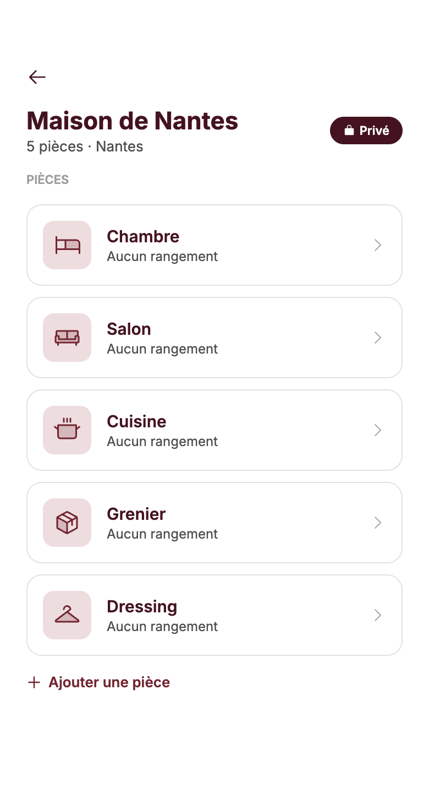
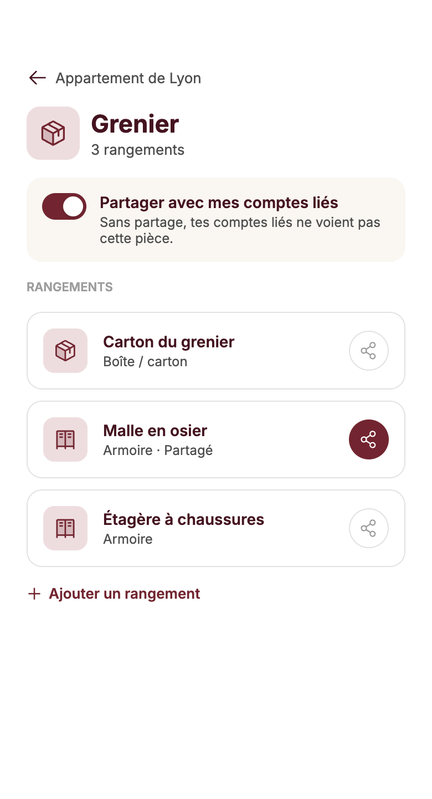
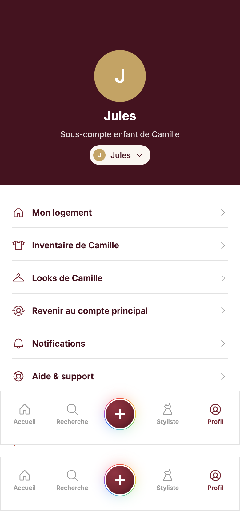
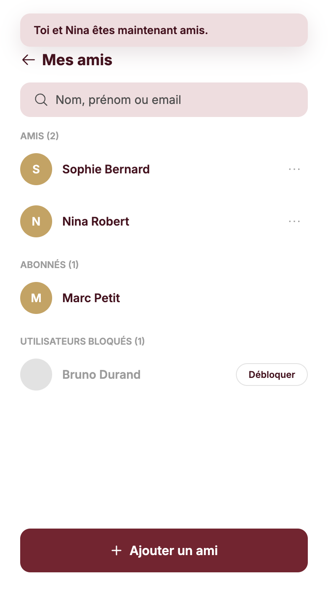
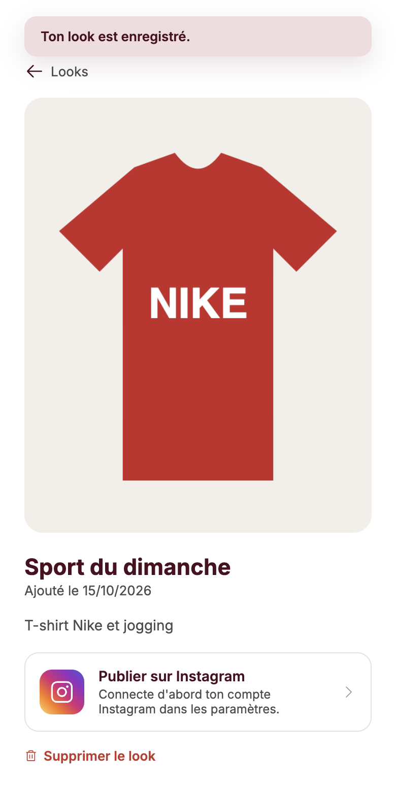

# Synthèse de la campagne de tests : Dressing

Branche `feature/test` (non fusionnée dans `develop`). Exécution du 15/10/2026, en local, sous Docker (PHP 8.5, MariaDB 12.3).

| Contrôle | Commande | Résultat |
|---|---|---|
| Tests unitaires | `make test-unitaires` | **178 tests, 392 assertions : OK** |
| Tests d'intégration | `make test-integration` | **37 tests, 330 assertions : OK** |
| Tests fonctionnels | `make test-fonctionnels` | **69 tests, 445 assertions : OK** |
| Couverture du code métier (unitaires + intégration) | `make couverture` | **100 % des lignes (776/776), méthodes (265/265) et classes (44/44)** |
| Analyse statique | `make phpstan` | **PHPStan niveau 6 : aucune erreur** |
| Linters Symfony | `make lint` | **Twig, YAML, conteneur et `composer.json` valides** |
| Sécurité des dépendances | `make securite` | **Aucune vulnérabilité connue (Composer et importmap)** |
| Bout en bout | `make e2e` | **37 scénarios Cypress, 11 parcours métier sur 11 : OK** |

Le choix des tests est justifié dans [coverage.md](coverage.md).

## Commandes (Makefile)

```bash
make test               # les 3 suites PHPUnit
make test-unitaires     # sans noyau ni base
make test-integration   # vrais services, base penderie_test
make test-fonctionnels  # parcours HTTP complets
make couverture         # unitaires + intégration : texte + HTML (var/couverture/html)
make qualite            # lint + phpstan + securite
make fixtures           # charge les données de test dans la base de dev
make sauvegarde         # copie la base de dev dans var/sauvegardes
make restauration       # remet la dernière sauvegarde (ou FICHIER=…)
make e2e                # Cypress sans fenêtre (base sauvegardée puis restaurée)
make e2e SPEC=cypress/e2e/looks.cy.js  # un seul fichier
make e2e-ouvrir         # Cypress en mode interactif, pour la démonstration
make tests              # toute la campagne : qualite + test + e2e
```

---

## 1. Tests PHPUnit (3 suites)


## 2. Couverture du code métier

Mesurée sur les suites unitaires et d'intégration seulement : les unitaires seuls couvrent 75,51 %, l'intégration seule 50 %, les deux ensemble 100 %.


## 3. Analyse statique (PHPStan niveau 6)


## 4. Linters Symfony et sécurité des dépendances


## 5. Tests de bout en bout (Cypress)

`make e2e` sauvegarde la base de développement, recharge les fixtures avant chaque fichier de scénarios, lance Cypress, puis restaure la base, même en cas d'échec.


| Fichier | Ce qui est vérifié |
|---|---|
| `connexion.cy.js` | Mauvais mot de passe refusé, accueil (statistiques, catégories, derniers objets), déconnexion |
| `inventaire.cy.js` | Inventaire complet, filtre par catégorie, recherche par marque, modification d'une fiche |
| `scan.cy.js` | Photo réduite et envoyée en base64, fiche pré-remplie par l'IA (simulée par `cy.intercept`), catégorie cochée, objet ajouté. Saisie manuelle quand l'IA échoue. |
| `categories.cy.js` | Création d'une catégorie perso, proposée au scan, puis supprimée ; nom en double refusé |
| `droits.cy.js` | Une amie voit les looks sans pouvoir les modifier ; un inconnu reçoit une 403 ; un objet personnel reste privé |
| `inscription.cy.js` | Création de compte, description du logement, choix des pièces ; email déjà utilisé refusé |
| `rangements.cy.js` | Ajout de rangements (partagé ou non), partage de la pièce ; ce que voient le compte lié, l'amie et un inconnu |
| `sous-comptes.cy.js` | Création d'un profil enfant, changement de profil, accès refusés (403), retour au compte principal par mot de passe, suppression |
| `relations.cy.js` | Demande d'ami et acceptation, abonnement, comptes liés par email, blocage et déblocage |
| `looks.cy.js` | Look sans photo refusé ; création avec photo, consultation, invitation Instagram, suppression |
| `profil.cy.js` | Modification du profil, compte public, changement de mot de passe puis reconnexion ; mot de passe actuel erroné refusé |

### Démonstration

`make e2e-ouvrir` ouvre l'interface de Cypress : on choisit un fichier, et chaque étape se rejoue dans le navigateur, avec l'état de la page à chaque commande. Les scénarios tournent en taille téléphone (390 × 844), l'application étant mobile first.

Captures prises par Cypress pendant les scénarios :

| Accueil | Inventaire | Scan : analyse terminée |
|---|---|---|
|  |  |  |

| Fiche de l'objet ajouté | Catégories | Look vu par une amie |
|---|---|---|
|  |  |  |

| Logement créé à l'inscription | Pièce partagée | Profil enfant actif |
|---|---|---|
|  |  |  |

| Amis | Look créé |
|---|---|
|  |  |

---

## Vers l'intégration continue

La campagne est découpée pour passer telle quelle en pipeline CI/CD (à mettre en place avec Thomas). Ordre proposé, du plus rapide au plus lent :

1. **Qualité** : `make qualite`, sans base, en quelques secondes.
2. **Unitaires** : `make test-unitaires`, sans base.
3. **Intégration et fonctionnels** : service MariaDB, puis `make test-integration test-fonctionnels`.
4. **Couverture** : `make couverture`, avec publication du rapport HTML en artefact.
5. **Bout en bout** : `make up`, `make fixtures`, puis `npx cypress run`. Les captures sont publiées en artefact en cas d'échec.

Aucune étape n'appelle de service payant ou externe : Zernio et OpenRouter sont simulés en PHPUnit, et l'IA est interceptée par Cypress.
