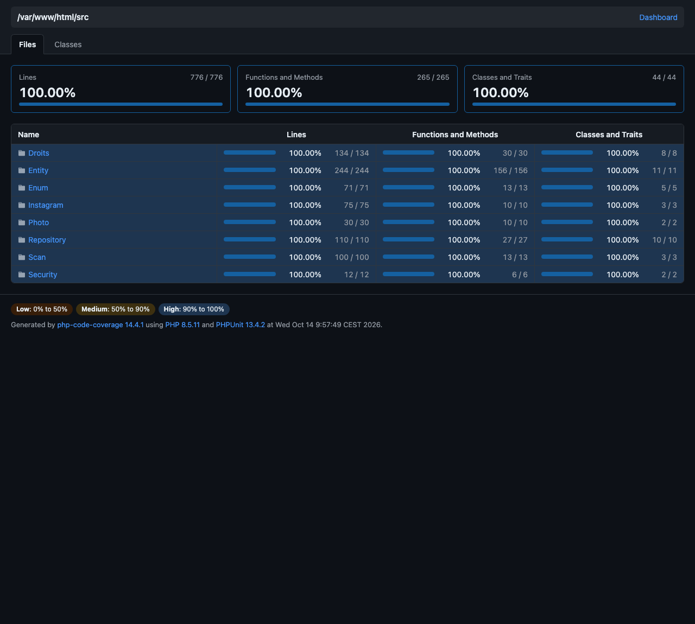

# Couverture des tests : Dressing

Branche `feature/test`. Campagne lancée le 14/10/2026 avec `make couverture` (PHPUnit 13 + PCOV, PHP 8.5).

## Résultat

| Mesure | Couvert | Total | Taux |
|---|---|---|---|
| Lignes | 776 | 776 | **100 %** |
| Méthodes | 265 | 265 | **100 %** |
| Classes | 44 | 44 | **100 %** |

Le détail ligne par ligne s'obtient avec `make couverture`, qui produit le rapport HTML dans `var/couverture/html/index.html`.

## Périmètre : la partie métier

La couverture mesurée (`<source>` dans `phpunit.dist.xml`) porte sur le code qui décide quelque chose :

| Dossier | Ce qu'il contient |
|---|---|
| `src/Droits` | Matrice « Qui a le droit de voir ? », relation entre membres, profil actif, liens (ami, compte lié, abonnement, blocage) |
| `src/Security` | Voters qui appliquent la matrice aux contrôleurs et aux templates |
| `src/Entity` | Règles portées par les entités (âge d'un sous-compte, statut d'un lien, rôles, catégories prédéfinies…) |
| `src/Enum` | Types métiers et règles associées (formats acceptés par Instagram…) |
| `src/Repository` | Requêtes : inventaire, comptes par catégorie, noms de catégories déjà pris, liens entre membres |
| `src/Scan` | Reconnaissance IA d'un objet : chaîne de modèles gratuits OpenRouter et nettoyage des réponses |
| `src/Photo` | Validation des photos reçues en base64 et stockage hors de `public/` |
| `src/Instagram` | Connexion et publication via l'API Zernio |

**Hors du périmètre chiffré**, mais testé quand même :

| Dossier | Raison | Où c'est testé |
|---|---|---|
| `src/Controller` | Code de liaison : lit la requête, appelle le métier, rend un template | 69 tests fonctionnels (`tests/Controller`) et 14 scénarios Cypress |
| `src/Form` | Déclaration des champs, sans règle propre | Tests fonctionnels, qui soumettent chaque formulaire |
| `src/Twig` | Fonctions d'affichage qui délèguent aux droits | Tests fonctionnels (présence ou absence des boutons selon le profil) |
| `src/DataFixtures` | Données de test | `tests/Integration/DataFixtures/FixturesTest.php` |
| `src/Kernel.php` | Fichier du framework | |

L'objectif de 100 % porte sur ce qui peut casser une règle. Ajouter les contrôleurs au chiffre l'aurait gonflé sans rien prouver de plus : ils sont déjà parcourus de bout en bout par les tests fonctionnels.

## Pyramide de tests

| Niveau | Suite | Commande | Tests | Durée | Rôle |
|---|---|---|---|---|---|
| Unitaire | `tests/Unitaire` | `make test-unitaires` | 131 | 0,15 s | Règles isolées, sans noyau ni base : les cas limites et les erreurs |
| Intégration | `tests/Integration` | `make test-integration` | 15 | 0,5 s | Vrais services du conteneur et vraie base `penderie_test`, sans HTTP |
| Fonctionnel | `tests/Controller` | `make test-fonctionnels` | 69 | 9 s | Parcours HTTP complets (`WebTestCase`), droits vus depuis l'interface |
| Bout en bout | `cypress/e2e` | `make e2e` | 14 | 33 s | Vrai navigateur sur le site en marche, JavaScript compris (Stimulus) |

La base de la pyramide est la plus large et la plus rapide : 131 tests en 0,15 s. Seuls les parcours qui ont besoin d'un navigateur montent jusqu'à Cypress.

## Choix des tests, domaine par domaine

### Droits d'accès : la règle la plus critique
- **`MatriceDroitsTest`** vérifie les 70 cellules de la matrice « Qui a le droit de voir ? » avec un fournisseur de données : une cellule fausse ouvrirait une donnée privée. Les cas conditionnels sont testés à part (pièce partagée, compte public, blocage).
- **`ProfilActifTest`** couvre les cas qu'un utilisateur ne produit pas en cliquant, mais qu'un attaquant peut fabriquer :
  - session qui pointe vers le sous-compte d'un autre compte ;
  - jeton sans utilisateur ;
  - sous-compte qui tente d'agir chez un autre membre.
- **`GestionLiensTest`** (intégration) : les règles des liens dépendent des liens déjà enregistrés. Elles sont donc testées sur la vraie base :
  - acceptation croisée ;
  - demande en double ;
  - blocage qui supprime les autres liens et empêche les nouvelles demandes ;
  - déblocage ;
  - impossibilité de se lier à soi-même.

### Scan IA : un service externe gratuit, donc instable
- **`AnalyseurObjetTest`** ne fait jamais d'appel réseau (`MockHttpClient`) et n'attend jamais (`MockClock`). Il couvre :
  - modèle injoignable ;
  - quota atteint ;
  - erreur cachée dans une réponse 200 ;
  - contenu renvoyé en morceaux ;
  - budget de 50 s épuisé ;
  - second tour après une pause.
- **Pour rendre ce code testable**, l'horloge est injectée dans `AnalyseurObjet` (`ClockInterface`). Sans ça, tester la limite de 50 s aurait pris 50 s, et la pause entre deux tours ralentissait chaque test d'une seconde.
- **`ResultatAnalyseTest`** : la réponse d'un modèle n'est pas fiable. Le test vérifie le nettoyage (balises, espaces), la troncature à la taille des colonnes, les valeurs « inconnue », les valeurs qui ne sont pas du texte et le rapprochement avec la liste des catégories.

### Photos : des données externes
- **`PhotoBase64Test`** fait passer, par un fournisseur de données, chaque façon de tromper le serveur :
  - type d'image non accepté ;
  - base64 invalide ;
  - fichier PHP déguisé en PNG ;
  - type annoncé différent du contenu ;
  - photo trop lourde, ou trop grande en pixels.
- **`StockagePhotosTest`** vérifie que le chemin d'une photo ne sort jamais de son dossier (`../../etc/passwd`), qu'une photo absente répond 404 et que la réponse est privée et `nosniff`.

### Instagram (Zernio)
- **`ClientZernioTest`** vérifie que chaque refus de l'API devient un message lisible : profil introuvable, erreur 500 sans message, service injoignable, adresse de connexion non HTTPS, envoi de photo refusé.
- Un lien de publication `javascript:` renvoyé par l'API n'est jamais conservé : il serait affiché tel quel dans la page.

### Entités et enums
- **On teste des comportements, pas des accesseurs isolés** :
  - un abonnement est accepté d'emblée, une demande d'ami attend ;
  - `ROLE_USER` n'est jamais en double ;
  - une catégorie prédéfinie n'a pas de propriétaire ;
  - un mineur sans niveau est refusé par le validateur.

  Les accesseurs sont couverts au passage.
- **`FormatPublicationTest`** vérifie les bornes exactes du feed Instagram (9:16 et 1,91:1), une valeur juste au-delà de chacune, et le cas d'une image illisible.
- **`eraseCredentials()`** est déprécié dans Symfony 7.4. Le test vérifie qu'il émet bien sa dépréciation, au lieu de l'exclure de la couverture.

### Fixtures
- **`FixturesTest`** charge les fixtures dans la base de test et vérifie qu'elles servent la campagne :
  - chaque compte se connecte avec le mot de passe de test ;
  - l'inventaire contient un objet personnel et un objet sans catégorie ;
  - chaque relation (propriétaire, amie, compte lié, abonné, inconnue, bloqué) obtient le bon droit sur un look.

## Règles suivies

- **Rien n'est exclu artificiellement** : aucun `@codeCoverageIgnore`, aucune exclusion de ligne. Les 100 % sont atteints en testant, pas en masquant.
- **Aucune API réelle en test** : Zernio et OpenRouter passent par `mock_response_factory` (`tests/Http/ReponsesHttp.php`). Les pannes se simulent modèle par modèle.
- **Indépendance** : chaque test repart d'une base vide, et les photos écrites sont supprimées à la fin.
- **Zéro tolérance** : `failOnDeprecation`, `failOnNotice` et `failOnWarning` restent activés, une simple dépréciation fait échouer la suite.

## Limites

- **La couverture prouve que chaque ligne est exécutée, pas que chaque assertion est pertinente.** La prochaine étape serait le test de mutation (Infection), qui modifie le code pour vérifier qu'un test échoue.
- **Le JavaScript (contrôleurs Stimulus) n'est pas compté** par PCOV. Il est couvert par Cypress : réduction et envoi de la photo en base64, remplissage par l'IA, catégorie cochée, feuille Instagram.

## Données de test (fixtures)

`make fixtures` charge `src/DataFixtures` dans la base de développement. Ta base réelle n'est pas perdue : `make sauvegarde` la copie avant, `make restauration` la remet, et `make e2e` fait les deux automatiquement.

| Compte | Rôle dans la matrice |
|---|---|
| `camille@dressing.test` | Propriétaire : logement, 11 objets, 2 looks, catégorie « Sport », sous-comptes Léo (majeur) et Emma (enfant) |
| `sophie@dressing.test` | Amie de Camille |
| `alex@dressing.test` | Compte lié à Camille |
| `marc@dressing.test` | Abonné à Camille (compte public) |
| `nina@dressing.test` | Aucun lien |
| `bruno@dressing.test` | Bloqué par Camille |

Mot de passe de tous les comptes de test : `motdepasse123`. Ces comptes n'existent que localement.
