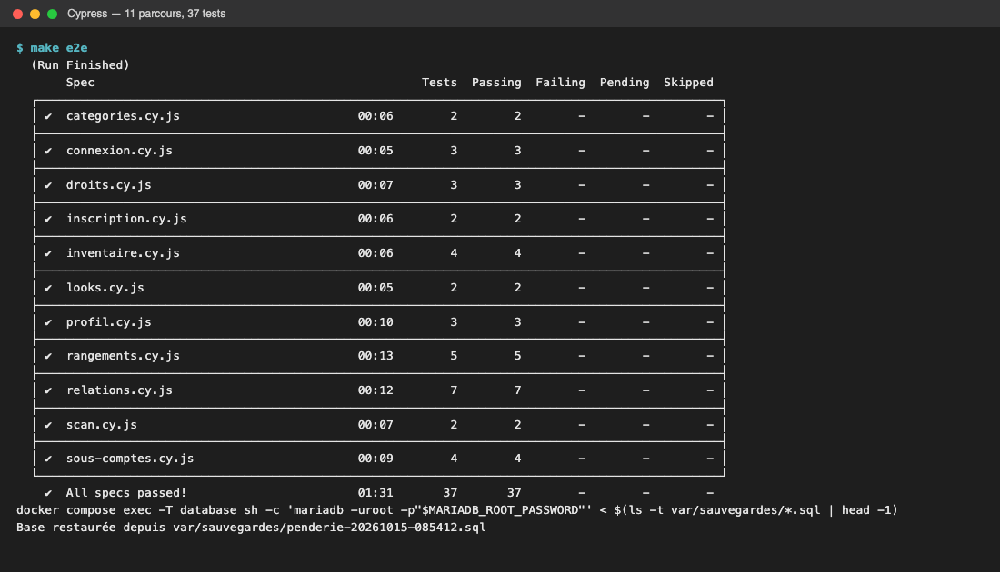

# Couverture et choix des tests : Dressing

Ce document explique **quels tests ont été écrits, pourquoi, et ce que chacun vérifie**. Il justifie aussi le périmètre de la couverture de code. Les résultats bruts et les captures sont dans [ci.md](ci.md), et l'audit qualité dans [audit.md](audit.md).

## En bref

| Ce qui était demandé | Résultat |
|---|---|
| Tests unitaires PHPUnit sur le code métier | **178 tests**, 392 assertions : OK |
| Tests d'intégration PHPUnit sur le code métier | **37 tests**, 330 assertions : OK |
| Couverture du code métier par unitaires + intégration | **100 %** des lignes (776/776), des méthodes (265/265) et des classes (44/44) |
| Tests fonctionnels PHPUnit (en plus, non comptés dans la couverture) | **69 tests**, 445 assertions : OK |
| Cypress : couverture des parcours métier | **11 parcours sur 11 (100 %)**, 37 scénarios : OK |
| Analyse statique | PHPStan niveau 6 : aucune erreur |

En tout : **284 tests PHPUnit** et **37 scénarios Cypress**, tous au vert.

---

## 1. Le vocabulaire à connaître

| Mot | Définition simple | Exemple dans le projet |
|---|---|---|
| **Test unitaire** | Teste **une seule classe isolée**, sans base de données, sans Symfony, sans réseau. Très rapide (178 tests en 0,2 s). | `MatriceDroitsTest` vérifie la matrice des droits sans aucune donnée. |
| **Test d'intégration** | Teste **plusieurs pièces qui travaillent ensemble** : vrais services Symfony et vraie base MariaDB (`penderie_test`). | `ControleAccesTest` charge les fixtures et vérifie les droits sur de vraies entités. |
| **Test fonctionnel** | Simule un **navigateur côté serveur** : envoie des requêtes HTTP à l'application et lit la page HTML renvoyée. | `LookTest` poste le formulaire d'un look et vérifie la redirection. |
| **Test de bout en bout (E2E)** | Un **vrai navigateur** (Cypress) clique dans l'application comme un utilisateur. | `relations.cy.js` : Nina demande Camille en amie, Camille accepte. |
| **Couverture de code** | Pourcentage des lignes de code exécutées au moins une fois pendant les tests. Mesurée par PCOV. | 776 lignes sur 776 exécutées. |
| **Assertion** | Une vérification dans un test (`assertSame`, `should('contain', …)`). Si elle est fausse, le test échoue. | `self::assertSame(Droit::Voir, …)` |
| **Fixture** | Jeu de **données de test** toujours identique, chargé en base avant les tests. | Camille, Sophie, Alex… (voir partie 4). |
| **Mock / doublure** | Faux objet qui **remplace un service externe** pour ne pas appeler Internet. | `MockHttpClient` remplace OpenRouter et Zernio ; `MockClock` remplace l'horloge. |
| **Data provider** | Une méthode qui fournit **plusieurs jeux de données au même test**. Un test est alors exécuté plusieurs fois. | `testCellule` tourne 70 fois, une fois par case de la matrice. |
| **Stub** | Doublure qui renvoie juste une valeur fixée (`createStub`). | Un `Security` qui renvoie toujours Camille. |

---

## 2. Pourquoi ces types de tests ? (la pyramide des tests)

```
              ▲  Cypress (37)        lent, vrai navigateur → les PARCOURS de l'utilisateur
             ▲▲▲ Fonctionnels (69)   requêtes HTTP → les PAGES et les CONTRÔLEURS
           ▲▲▲▲▲ Intégration (37)    vraie base → les REQUÊTES et les RÈGLES sur vraies données
        ▲▲▲▲▲▲▲▲ Unitaires (178)     classes isolées → la LOGIQUE MÉTIER, cas par cas
```

- **Beaucoup de tests unitaires** : ils sont instantanés et indiquent exactement quelle classe est cassée. On y met tous les cas limites (photo trop lourde, modèle d'IA en panne, date de naissance la veille des 18 ans…).
- **Des tests d'intégration** pour ce qu'un test unitaire **ne peut pas prouver** : qu'une requête SQL Doctrine renvoie le bon résultat, ou que les droits sont justes sur des données réellement enregistrées.
- **Des tests fonctionnels** pour vérifier que chaque page répond correctement (200, 403, 422, redirection) et que les formulaires sont branchés.
- **Peu de tests Cypress**, mais un par parcours métier : ils sont lents, donc on ne teste que les chemins qu'un vrai utilisateur suit.

Chaque niveau couvre ce que le niveau du dessous ne voit pas. C'est pour cela qu'il y a 4 niveaux et pas un seul.

---

## 3. Le périmètre de la couverture : pourquoi « 100 % du métier » ?

### Ce qui est compté (le code métier)

Le périmètre est fixé dans `phpunit.dist.xml` (balise `<source>`) :

| Dossier | Ce qu'il contient | Pourquoi c'est du métier |
|---|---|---|
| `src/Droits` | Matrice des droits, relations, sous-comptes actifs, gestion des liens | Les règles « qui a le droit de voir quoi » : le cœur de l'application |
| `src/Entity` | Logement, Pièce, Rangement, Objet, Look, Catégorie, Lien… | Les données et leurs règles (normalisation, majorité, légende par défaut) |
| `src/Enum` | Types de logement, de pièce, niveaux de sous-compte, formats Instagram | Valeurs métier, libellés et règles (formats acceptés par Instagram) |
| `src/Instagram` | Client Zernio (connexion, publication) | Règles de publication et gestion des refus |
| `src/Photo` | Validation et stockage des photos | Sécurité : type, poids, dimensions, chemins |
| `src/Repository` | Requêtes Doctrine | Ce que l'utilisateur voit dans les listes (filtres, tris, recherche) |
| `src/Scan` | Analyse IA via OpenRouter | Chaîne de secours entre modèles, nettoyage des réponses |
| `src/Security` | Voters (`VOIR`, `MODIFIER`, `COMPTE_PRINCIPAL`) | Porte d'entrée des droits dans les contrôleurs et les templates |

### Ce qui n'est pas compté, et pourquoi

| Dossier | Raison |
|---|---|
| `src/Controller` | Ce sont des « aiguilleurs » : ils reçoivent la requête et appellent le métier. Ils sont testés par les **tests fonctionnels** et **Cypress**, pas par des tests unitaires. |
| `src/Form` | Descriptions de formulaires (champs, libellés). Testées en fonctionnel quand on soumet les formulaires. |
| `src/Twig` | Petites fonctions d'affichage, vérifiées par l'affichage des pages. |
| `src/DataFixtures` | Ce sont les données de test elles-mêmes. Leur bon chargement est quand même vérifié par `FixturesTest`. |
| `Kernel.php` | Fichier de démarrage de Symfony, sans logique. |

**Choix retenu : unitaires + intégration ensemble = 100 %.** Les tests fonctionnels ne sont pas comptés, car ils passent par les contrôleurs et « couvrent » du code sans vraiment le vérifier en détail. On veut que chaque ligne métier soit exécutée par un test **ciblé**.

| Suite lancée seule | Couverture du métier |
|---|---|
| Unitaires seuls | 75,51 % (586/776) |
| Intégration seule | 50,00 % (388/776) |
| **Unitaires + intégration** | **100 % (776/776)** |

Les deux suites sont **complémentaires**. Les unitaires ne peuvent pas exécuter les requêtes SQL des repositories ni la validation Symfony. L'intégration, elle, ne teste pas tous les cas limites (pannes d'IA, photos invalides…).


> **100 % de couverture ne veut pas dire « zéro bug ».** Cela veut dire qu'aucune ligne métier n'a été oubliée. La qualité vient des **assertions** : chaque test vérifie un résultat précis, il ne se contente pas d'exécuter le code.

---

## 4. Les données de test (fixtures)

Les fixtures (`src/DataFixtures`) créent toujours le même petit monde, centré sur **Camille**. Chaque personnage représente **une relation** de la matrice des droits. Mot de passe commun : `motdepasse123`.

| Compte | Relation avec Camille | Sert à tester |
|---|---|---|
| **Camille** | Propriétaire | Tout est modifiable |
| **Léo** (sous-compte, 19 ans) | Sous-compte +18 | Presque tout, sauf l'objet personnel |
| **Emma** (sous-compte, 9 ans, mode simplifié) | Sous-compte enfant | Lecture, ajout de rangements |
| **Alex** | Compte lié (accepté) | Voit les pièces seulement si elles sont partagées |
| **Sophie** | Amie (acceptée) | Lecture, rangements partagés, looks |
| **Marc** | Abonné, compte public | Rangements partagés et looks seulement |
| **Nina** | Inconnue | Rien, sauf les looks d'un compte public |
| **Bruno** | Bloqué par Camille | Rien du tout |

Camille possède aussi :

- le logement « Appartement de Lyon », avec trois pièces : Chambre (non partagée), Dressing (partagée) et Grenier ;
- quatre rangements : Armoire (privée), Commode (partagée), Penderie et Carton du grenier ;
- 11 objets, dont le « Journal intime » (objet personnel) et la « Boîte à couture » (sans catégorie) ;
- la catégorie personnelle « Sport » et 2 looks.

**Pourquoi des fixtures ?** Les tests partent toujours du même état : un résultat qui change ne peut venir que du code, pas des données. Elles servent aussi pour la démonstration (`make fixtures`).

---

## 5. Les tests unitaires (178 tests) : `tests/Unitaire`

Ils n'utilisent ni base de données ni réseau.

### 5.1 Les droits : `Droits/MatriceDroitsTest.php` (75 tests)

La matrice « Qui a le droit de voir ? » est recopiée dans le test sous forme de tableau (`M`, `V`, `R`), puis comparée au code case par case.

| Test | Ce qu'il vérifie | Pourquoi c'est pertinent |
|---|---|---|
| `testCellule` (×70) | Chaque case : 10 ressources × 7 relations → Modifier, Voir ou Rien | Si quelqu'un modifie une règle par erreur, la case exacte est signalée |
| `testToutesLesRessourcesSontCouvertes` | Toute ressource du code a ses cases dans le test | Une nouvelle ressource sans test fait échouer la suite |
| `testPieceVisibleDuCompteLieSeulementSiPartagee` | Un compte lié voit une pièce **seulement** si elle est partagée | Règle conditionnelle, impossible à mettre dans un tableau simple |
| `testLookVisibleDesInconnusSeulementSiComptePublic` | Un inconnu voit les looks **seulement** si le compte est public | Autre règle conditionnelle |
| `testUnMembreBloqueNAccedeARien` | Un membre bloqué n'a aucun droit, même si tout est partagé et public | Le blocage doit toujours l'emporter |
| `testComparaisonDesDroits` | Modifier inclut Voir ; « plafonner » limite un droit | Utilisé pour la vue limitée des enfants |

### 5.2 Le profil actif : `Droits/ProfilActifTest.php` (4 tests)

| Test | Ce qu'il vérifie |
|---|---|
| `testSansUtilisateurConnecteIlNYAPasDActeur` | Pas connecté = pas d'acteur, donc aucun droit |
| `testUnSousCompteDUnAutreCompteEstRetireDeLaSession` | Un profil d'un **autre** compte glissé dans la session est ignoré et retiré (sécurité) |
| `testUnSousCompteNADeDroitsQueChezSonComptePrincipal` | Un sous-compte est un inconnu chez les autres membres |
| `testLeVoterRefuseUnJetonSansUtilisateur` | Le voter refuse quand il n'y a personne de connecté |

### 5.3 Les voters : `Security/VotersTest.php` (9 tests)

| Test | Ce qu'il vérifie |
|---|---|
| `testDroitsVoter` (×4, data provider) | La propriétaire voit et modifie son logement ; un inconnu est refusé ; un attribut étranger (`ROLE_ADMIN`) est ignoré (abstention) |
| `testLeVoterIgnoreUnSujetQuiNEstPasUneRessource` | Le voter s'abstient sur un objet qui n'est pas une ressource |
| `testSeulLeCompteprincipalGereLeCompte` | `COMPTE_PRINCIPAL` est accordé au compte principal et refusé sans connexion |
| `testActiverUnSousCompteRetireLesDroitsDuComptePrincipal` | Passer sur le profil d'Emma retire les droits de gestion du compte, puis revenir les rend |
| `testLeLibelleDeChaqueRelation` | Chaque relation a son libellé affiché (« Ami », « Bloqué »…) |
| `testLIdentiteAfficheeDeLActeur` | Prénom, initiale et libellé affichés pour le compte principal ou un sous-compte |

### 5.4 Les entités : `Entity/EntitesTest.php` et `Entity/AccesseursTest.php` (16 tests)

| Test | Ce qu'il vérifie |
|---|---|
| `testUneCategoriePredefinieNAPasDeProprietaire` | Les 12 catégories communes n'appartiennent à personne |
| `testLeNomDUneCategorieEstNormalise` | « `  Tenues   de  sport ` » devient « Tenues de sport » ; un nom vide devient nul |
| `testUneDemandeDAmiAttendLAcceptation` | Une demande d'ami commence « en attente » |
| `testUnAbonnementEstImmediat` | S'abonner ne demande pas d'acceptation |
| `testLogementPiecesEtRangements` | Logement → pièce → rangement sont bien reliés |
| `testUnePublicationSAjouteAuLook` | Une publication Instagram est rattachée à son look |
| `testRolesEtCollectionsDuCompte` | `ROLE_USER` est toujours présent ; sous-comptes et logements ajoutés |
| `testEffacerLesIdentifiantsEstDeprecie` | `eraseCredentials()` signale bien sa dépréciation (Symfony 7.3+) |
| `testUnCompteNormaliseSonEmailEtCalculeSonIdentite` | Email mis en minuscules et sans espaces ; nom complet ; initiale « É » avec accent |
| `testLaSessionNeContientJamaisLeHashDuMotDePasse` | **Sécurité** : la session stocke une empreinte du mot de passe, jamais le hash |
| `testUnObjetNettoieSesChamps` | Les saisies sont nettoyées (espaces, champ vide → nul) |
| `testLaLegendeParDefautDUnLook` | Sans description, le titre sert de légende Instagram |
| `testUnSousCompteMajeurNAPasDeNiveau` | Le niveau (simplifié, vue limitée…) ne concerne que les enfants ; la majorité se calcule au jour près (la veille des 18 ans, on est encore mineur) |
| `testLAutreMembreDUnLien` | Dans un lien, on retrouve « l'autre » membre dans les deux sens |
| `testLogementPieceEtRangement` | Getters, nom par défaut d'une pièce prédéfinie, icône « Autre » de repli |
| `testCompteEtPublicationInstagram` | URL du profil Instagram encodée ; données de la publication conservées |

### 5.5 Les énumérations : `Enum/FormatPublicationTest.php` et `Enum/TypesTest.php` (33 tests)

| Test | Ce qu'il vérifie |
|---|---|
| `testAccepteDimensions` (×7) | Le feed Instagram accepte du 9:16 au 1,91:1 et refuse au-delà ; la story accepte tout |
| `testLibellesEtIcones` | Chaque format a un libellé et une icône |
| `testLibelleEtIconeExistante` (×23) | Chaque type (logement, pièce, rangement, niveau) a un libellé et une **icône qui existe vraiment** dans `assets/icons/ph` |
| `testChaqueNiveauDeSousCompteEstExplique` | Chaque niveau de sous-compte a une description pour l'utilisateur |
| `testLesPiecesProposeesExcluentLaPiecePersonnalisee` | La grille de pièces ne propose pas « Personnalisée » |

### 5.6 Les photos : `Photo/PhotoBase64Test.php` et `Photo/StockagePhotosTest.php` (13 tests)

La photo envoyée par le téléphone est une **donnée externe** : elle doit être contrôlée.

| Test | Ce qu'il vérifie |
|---|---|
| `testUnePhotoValideEstDecodeeEtReencodee` | Une vraie photo est acceptée et ré-encodée |
| `testUnePhotoInvalideEstRefusee` (×7) | Refus quand ce n'est pas une data URL, que le type est un GIF, que le base64 est cassé, que le fichier est du code PHP déguisé ou une photo dont le type annoncé est faux, ou que la photo est trop lourde ou trop grande |
| `testUnFichierEnvoyeEstRangeSousUnNomAleatoire` | Le nom du fichier est aléatoire : on ne peut pas deviner les photos des autres |
| `testUnePhotoDecodeeEstEnregistreeEtServie` | La photo enregistrée est bien servie ensuite |
| `testLeCheminNeSortJamaisDuDossier` | **Sécurité** : un nom du type `../../.env` ne permet pas de sortir du dossier (*path traversal*) |
| `testUnePhotoAbsenteRepond404` | Une photo manquante donne une erreur 404 propre |
| `testSuppression` | La photo est supprimée du disque |

### 5.7 Le scan IA : `Scan/AnalyseurObjetTest.php` et `Scan/ResultatAnalyseTest.php` (12 tests)

OpenRouter est remplacé par `MockHttpClient`, et l'horloge par `MockClock` : **aucun appel réseau et aucune attente réelle**.

| Test | Ce qu'il vérifie |
|---|---|
| `testSansCleLAnalyseNEstPasDisponible` | Sans clé API, le scan reste manuel |
| `testLaListeDeModelesPeutVenirDeLEnvironnement` | La liste des modèles peut venir de `OPENROUTER_MODELES`, nettoyée |
| `testUneCleRefuseeArreteToutDeSuite` | Une clé refusée (401) arrête tout après **un seul** appel : inutile d'essayer les autres modèles |
| `testUnModeleInjoignableFaitPasserAuSuivant` | Un modèle en panne → on passe au suivant (chaîne de secours) |
| `testUnContenuEnMorceauxEstRecolle` | Une réponse découpée en morceaux est recollée |
| `testUnContenuQuiNEstPasDuTexteEstInexploitable` | Une réponse illisible fait passer au modèle suivant |
| `testLeBudgetDeTempsArreteLaChaine` | Au bout de 50 s, on s'arrête (nginx couperait à 60 s) |
| `testLaPauseEntreLesToursUtiliseLHorloge` | Le second tour attend 1 s, simulée par l'horloge : le test reste instantané |
| `testLesValeursSontNettoyeesEtTronquees` | La réponse de l'IA est nettoyée et coupée à la bonne longueur |
| `testUneReponseSansNomNiTypeNiCategorieEstVide` | Une réponse vide ne pré-remplit rien |
| `testLaCategorieEstRapprocheeDeLaListeSansTenirCompteDeLaCasse` | « hauts » renvoyé par l'IA retrouve la catégorie « Hauts » du compte |
| `testUneCategorieHorsListeDevientLeType` | Une catégorie inventée par l'IA n'est pas créée : elle sert de type |

### 5.8 Instagram via Zernio : `Instagram/ClientZernioTest.php` et `ClientZernioPublicationTest.php` (16 tests)

Zernio est remplacé par `MockHttpClient` : on ne publie **rien** pour de vrai.

| Test | Ce qu'il vérifie |
|---|---|
| `testSansCleNiProfilLaConnexionEstDesactivee` | Sans clé, la fonction est désactivée proprement |
| `testUneAdresseDeConnexionNonHttpsEstRefusee` | **Sécurité** : une adresse d'autorisation non HTTPS est refusée |
| `testUnRefusDeZernioRemonteSonMessage` / `testUnRefusSansMessageAfficheLeStatut` | Les erreurs sont expliquées à l'utilisateur |
| `testZernioInjoignable` / `testUnStockageInjoignable` | Panne réseau gérée sans plantage |
| `testUnCompteAbsentDuProfil` / `testUnCompteDejaRetireNEstPasUneErreur` | Cas d'un compte déjà déconnecté |
| `testUnePhotoIntrouvableNEstPasEnvoyee` / `testSansAdresseDEnvoiLaPublicationEchoue` / `testUnEnvoiDePhotoRefuseParLeStockage` | Chaque étape de l'envoi de la photo peut échouer proprement |
| `testUnLienDePublicationNonHttpsNEstPasConserve` | On ne garde pas un lien douteux |
| `testLAdresseDeConnexionEstDemandeePourLeProfil` | L'adresse de connexion est demandée pour le bon profil, avec la bonne URL de retour |
| `testUnCompteInstagramDuProfilEstRetrouve` | Le compte Instagram est retrouvé parmi d'autres réseaux ; le nom affiché sert de repli |
| `testUnePublicationEnStoryLeSignaleAZernio` | Une story envoie `contentType = story` |
| `testUnRefusDInstagramRemonteSaRaison` | Un refus d'Instagram (réponse 207) affiche sa raison |

---

## 6. Les tests d'intégration (37 tests) : `tests/Integration`

Ils démarrent le noyau Symfony et utilisent la **vraie base** `penderie_test`. `IntegrationTestCase` vide la base avant chaque test et fournit `chargerFixtures()` et `compte()`.

### 6.1 Les droits sur de vraies données : `Droits/ControleAccesTest.php` (13 tests)

C'est **le test le plus important du projet** (voir partie 9). Pour 10 ressources de Camille, on vérifie le droit obtenu par chacun des 8 personnages des fixtures.

| Test | Ce qu'il vérifie |
|---|---|
| `testChaqueRelationObtientLeDroitDeLaMatrice` (×10) | Logement, Chambre, Dressing, Armoire, Commode, objet, objet personnel, catégorie perso, catégorie prédéfinie, look : le bon droit pour les 8 acteurs |
| `testLaRelationEstCalculeeDepuisLesLiensEnregistres` | La relation est déduite des liens en base : amie, compte lié, abonné, bloqué… |
| `testLaVueLimiteeEstEnLectureSeule` | Un enfant en « vue limitée » ne fait plus que voir |
| `testUnSujetInconnuNeDonneAucunDroit` | Par défaut : aucun droit (principe du refus par défaut) |

### 6.2 Les relations : `Droits/GestionLiensTest.php` (8 tests)

| Test | Ce qu'il vérifie |
|---|---|
| `testUneDemandeCroiseeEstAccepteeDOffice` | Si A demande B alors que B a déjà demandé A, ils deviennent amis directement |
| `testUneDemandeEnDoubleEstRefusee` | Pas deux demandes identiques |
| `testDejaAmisOuDejaLies` | Message clair si le lien existe déjà |
| `testAccepterUneDemandeDisparue` | Accepter une demande annulée entre-temps ne plante pas |
| `testRetirerUnAmiDansLesDeuxSens` | Retirer un ami fonctionne quel que soit celui qui a demandé |
| `testSAbonnerUneSeuleFoisPuisSeDesabonner` | Un seul abonnement, puis désabonnement |
| `testBloquerSupprimeLesAutresLiensEtEmpecheLesDemandes` | Bloquer supprime l'amitié, la liaison et l'abonnement, et empêche toute nouvelle demande |
| `testOnNeSeLieNiNeSeBloqueSoiMeme` | Impossible de se demander soi-même en ami ou de se bloquer |

### 6.3 Les requêtes : `Repository/RepositoriesTest.php` et `UserRepositoryTest.php` (11 tests)

| Test | Ce qu'il vérifie |
|---|---|
| `testLesCategoriesPredefiniesPuisPersonnelles` | Les 12 catégories communes dans l'ordre, puis « Sport » ; Sophie ne voit pas « Sport » |
| `testUnNomDeCategorieDejaPris` | « HAUTS » est déjà pris (sans tenir compte de la casse) ; on peut garder son propre nom en modifiant |
| `testLesRangementsDUnMembre` | Les rangements de Camille dans l'ordre ; seule la Commode est partagée |
| `testLInventaireEtSesComptesParCategorie` | 11 objets ; 2 « Hauts » ; l'objet sans catégorie n'est compté nulle part |
| `testLesLooksDuPlusRecentAuPlusAncien` | Le dernier look créé est affiché en premier |
| `testLesLiensAcceptesRecusEtEnvoyes` | Listes des amis, des demandes reçues et des demandes envoyées |
| `testLaRechercheDeMembres` | Recherche par prénom, nom ou email exact ; on ne se trouve pas soi-même ; 2 caractères minimum ; **les jokers SQL `%` sont échappés** |
| `testLeCompteInstagramDUnMembre` | Le compte Instagram relié est retrouvé |
| `testLesDepotsSimples` | Les dépôts de base répondent |
| `testLeNouveauHashEstEnregistre` | Quand Symfony renforce le hachage d'un mot de passe, le nouveau est enregistré |
| `testUnAutreTypeDUtilisateurEstRefuse` | Le dépôt refuse un utilisateur d'un autre type |

### 6.4 Validation et fixtures : `Entity/SousCompteValidationTest.php` et `DataFixtures/FixturesTest.php` (5 tests)

| Test | Ce qu'il vérifie |
|---|---|
| `testUnMineurSansNiveauEstRefuse` | Un enfant doit avoir un niveau de permissions (règle `Assert\Callback`) |
| `testUnMineurAvecNiveauOuUnMajeurSontAcceptes` | Cas valides acceptés |
| `testLesComptesSontUtilisablesAvecLeMotDePasseDeTest` | Tous les comptes des fixtures se connectent avec `motdepasse123` |
| `testLInventaireEtLesCategoriesSontEnPlace` | Les fixtures contiennent bien 11 objets, 2 looks, l'objet personnel et l'objet sans catégorie |
| `testChaqueRelationDonneLesDroitsAttendusSurUnLook` | Les fixtures donnent les bons droits sur un look : elles sont utilisables pour la démonstration |

Ces deux tests ne pouvaient pas être unitaires. La validation `Assert\Callback` a besoin du validateur Symfony, et les fixtures ont besoin de la base.

---

## 7. Les tests fonctionnels (69 tests) : `tests/Controller`

Ils ne sont pas comptés dans les 100 %, mais ils vérifient que **chaque page** répond comme prévu. Les appels à OpenRouter et Zernio y sont simulés par `tests/Http/ReponsesHttp.php`.

| Fichier | Tests | Ce qui est vérifié |
|---|---|---|
| `CompteTest.php` | 9 | Pages protégées → connexion ; inscription (email en double, mot de passe trop court) ; connexion et déconnexion ; modification du profil sans être déconnecté ; changement de mot de passe |
| `LogementTest.php` | 6 | Création du logement et des pièces ; au moins une pièce obligatoire ; ajout d'un rangement ; pas d'accès au logement d'un autre |
| `DroitsTest.php` | 13 | Amie en lecture seule ; compte lié selon le partage ; abonné ; inconnu ; blocage ; demande d'ami ; invitation par email ; sous-comptes (enfant, vue limitée, majeur) ; retour au compte principal par mot de passe |
| `CategorieTest.php` | 5 | Catégories communes visibles par tous ; créer, modifier, supprimer ; nom en double ; l'amie ne voit pas les catégories perso ; l'enfant ne peut pas en créer |
| `InventaireTest.php` | 5 | Filtres par catégorie, recherche, accueil, modification d'une fiche |
| `ObjetTest.php` | 14 | Scan : photo en base64 au premier modèle gratuit, chaîne de secours, saisie manuelle si tout échoue, limite de 10 analyses par minute, photo falsifiée refusée, objet personnel, suppression |
| `LookTest.php` | 11 | Création avec photo, photo obligatoire, visibilité (inconnu, amie, sous-compte), publication en feed et en story, photo trop étirée, refus d'Instagram, suppression |
| `InstagramTest.php` | 6 | Connexion puis déconnexion ; `etat` falsifié refusé ; refus de l'utilisateur ; compte relié à un seul compte Dressing |

---

## 8. Cypress : 100 % des parcours métier (37 scénarios)

Cypress pilote un **vrai navigateur**, en taille téléphone (390 × 844), car l'application est pensée d'abord pour le mobile. Avant chaque fichier, `cy.task('chargerFixtures')` remet la base dans l'état des fixtures. `make e2e` **sauvegarde la base de développement avant** les tests et la **restaure après**, même en cas d'échec.



### 8.1 Liste des parcours métier et leur couverture

| # | Parcours métier | Fichier Cypress | Scénarios | Couvert |
|---|---|---|---|---|
| 1 | Créer un compte, décrire son logement, choisir ses pièces | `inscription.cy.js` | 2 | ✅ |
| 2 | Se connecter, voir l'accueil, se déconnecter | `connexion.cy.js` | 3 | ✅ |
| 3 | Ajouter des rangements, partager une pièce et un rangement | `rangements.cy.js` | 5 | ✅ |
| 4 | Scanner un objet avec l'IA (ou à la main si l'IA échoue) | `scan.cy.js` | 2 | ✅ |
| 5 | Consulter, filtrer, rechercher et modifier l'inventaire | `inventaire.cy.js` | 4 | ✅ |
| 6 | Gérer ses catégories personnelles | `categories.cy.js` | 2 | ✅ |
| 7 | Créer, consulter et supprimer un look | `looks.cy.js` | 2 | ✅ |
| 8 | Amis, abonnement, comptes liés, blocage | `relations.cy.js` | 7 | ✅ |
| 9 | Sous-comptes : créer, changer de profil, revenir au compte principal | `sous-comptes.cy.js` | 4 | ✅ |
| 10 | Voir le contenu d'un autre membre selon ses droits | `droits.cy.js` | 3 | ✅ |
| 11 | Modifier son profil et son mot de passe | `profil.cy.js` | 3 | ✅ |
| | **Total** | **11 fichiers** | **37** | **11/11 = 100 %** |

### 8.2 Le détail de chaque scénario

**`inscription.cy.js`**
1. Léa crée son compte. Elle arrive sur la description du logement (« Maison de Nantes », type Maison), coche le Dressing en plus des pièces proposées et arrive sur son logement avec ses pièces.
2. Un email déjà utilisé est refusé.

**`connexion.cy.js`**
1. Un mauvais mot de passe affiche « Identifiants invalides. »
2. L'accueil affiche « Bonjour Camille », 11 objets, les catégories et les 4 derniers objets.
3. La déconnexion ramène à l'écran d'accueil public.

**`rangements.cy.js`**
1. Alex (compte lié) reçoit une **403** sur le Grenier, qui n'est pas partagé.
2. Camille ajoute « Malle en osier » (partagée) et « Étagère à chaussures » (privée), puis active l'interrupteur de partage de la pièce.
3. Alex voit maintenant le Grenier et ses deux rangements.
4. Sophie (amie) ne voit **que** le rangement partagé et ne peut rien ajouter.
5. Nina (inconnue) reçoit une **403**.

**`scan.cy.js`**
1. La photo est envoyée, la réponse de l'IA est simulée (`cy.intercept`) et la fiche se remplit avec la catégorie « Hauts » cochée. L'objet est ajouté.
2. Si l'IA échoue, l'utilisateur remplit la fiche à la main.

**`inventaire.cy.js`**
1. Les 11 objets sont affichés.
2. Le filtre « Hauts » ne garde que les hauts.
3. La recherche « sandro » retrouve le manteau.
4. La « Boîte à couture » est modifiée : nouvelle catégorie Déco et nouveau nom.

**`categories.cy.js`**
1. « Vacances » est créée, proposée au scan, puis supprimée.
2. « hauts » est refusé, car le nom existe déjà.

**`looks.cy.js`**
1. Un look sans photo est refusé.
2. Un look est créé avec sa photo (`selectFile`), puis consulté : titre, description et photo servie après contrôle des droits. L'appli invite à connecter Instagram, puis le look est supprimé.

**`relations.cy.js`**
1. Nina reçoit une 403 sur un look de Camille, la cherche et lui envoie une demande d'ami.
2. Camille accepte. Nina voit maintenant le look (200).
3. Nina s'abonne à Camille, puis se désabonne.
4. Camille invite Sophie par email à lier leurs comptes, et Sophie accepte.
5. Un email inconnu ne crée aucune invitation.
6. Camille bloque Nina : l'amitié disparaît et le look redevient interdit (403).
7. Camille débloque Bruno depuis sa liste.

**`sous-comptes.cy.js`**
1. Camille crée le profil de Jules (enfant, vue limitée).
2. Elle passe sur le profil de Jules. Il reçoit une **403** sur les paramètres, la gestion des sous-comptes et la création de look, voit 10 objets sur 11 (pas le journal intime) et n'a pas de bouton « Modifier ».
3. Le retour au compte principal exige le mot de passe : un mauvais mot de passe est refusé, le bon fonctionne.
4. Le profil de Jules est supprimé.

**`droits.cy.js`**
1. Sophie (amie) voit les looks de Camille, sans les boutons de publication ni de suppression.
2. Nina reçoit une 403 sur le look et sur sa photo.
3. Le « Journal intime » (objet personnel) renvoie une 403 à Sophie.

**`profil.cy.js`**
1. Alex change son nom et rend son compte public.
2. Alex change son mot de passe et reste connecté. Ensuite, l'ancien mot de passe est refusé et le nouveau fonctionne.
3. Un mot de passe actuel erroné est refusé.

### 8.3 Ce qui est volontairement simulé dans Cypress

| Élément | Comment | Pourquoi |
|---|---|---|
| **Réponse de l'IA** (OpenRouter) | `cy.intercept('/objets/analyser')` | Un modèle gratuit répond en un temps variable et parfois pas du tout : le test serait instable. Une vraie clé API serait aussi consommée à chaque lancement. |
| **Publication réelle sur Instagram** (Zernio) | Non lancée en bout en bout | Elle publierait une vraie photo sur un vrai compte Instagram, à chaque lancement. Ce parcours est couvert par les tests fonctionnels (`LookTest`, `InstagramTest`) et unitaires (`ClientZernio*Test`) avec un faux serveur Zernio. Cypress vérifie quand même l'invitation à connecter Instagram. |

Le scénario utilisateur reste donc complet, sans dépendre d'un service extérieur.

---

## 9. Deux tests pertinents à présenter

### En PHPUnit : la matrice des droits sur de vraies données

`tests/Integration/Droits/ControleAccesTest.php`

```php
// Ressources de Camille. Droit attendu pour : Camille, Léo (+18), Emma (enfant),
// Alex (lié), Sophie (amie), Marc (abonné), Nina (inconnue), Bruno (bloqué)
yield 'pièce non partagée (Chambre)' => ['piece:Chambre', [$m, $m, $v, $r, $v, $r, $r, $r]];
yield 'objet personnel' => ['objet:Journal intime', [$m, $r, $r, $r, $r, $r, $r, $r]];
yield 'look (compte privé)' => ['look', [$m, $v, $v, $v, $v, $v, $r, $r]];

#[DataProvider('ressources')]
public function testChaqueRelationObtientLeDroitDeLaMatrice(string $ressource, array $attendus): void
{
    $sujet = $this->ressource($ressource);

    foreach ($this->acteurs() as $rang => [$nom, $acteur]) {
        self::assertSame($attendus[$rang], $this->controle->droitSur($acteur, $sujet), sprintf('%s sur %s', $nom, $ressource));
    }
}
```

**Pourquoi il est pertinent :**

- Il vérifie **la règle la plus importante** de l'application : la vie privée. Qui voit quoi ?
- Il travaille sur des **données réelles** : les liens d'amitié, de blocage et les sous-comptes sont lus en base, comme en production.
- Une ligne du tableau égale une ligne de la maquette « Qui a le droit de voir ? ». Le test se lit **comme le cahier des charges**.
- En cas d'erreur, le message indique précisément qui et sur quoi (« Nina sur look »).

### En Cypress : le blocage coupe l'accès

`cypress/e2e/relations.cy.js`

```js
it('Camille bloque Nina : l\'amitié disparaît et le look redevient interdit', () => {
    cy.connexion(COMPTES.camille);
    cy.visit('/amis');
    cy.contains('.ligne-membre__identite', 'Nina').click();
    cy.contains('button', 'Bloquer').click();

    cy.get('.flash').should('contain', 'Nina est bloqué.');
    cy.contains('button', 'Ajouter en ami').should('not.exist');

    cy.connexion(COMPTES.nina);
    cy.request({ url: urlLook, failOnStatusCode: false }).its('status').should('eq', 403);
});
```

**Pourquoi il est pertinent :** il suit un vrai utilisateur qui clique et vérifie ce qu'il voit. Ensuite, il se met **à la place de la personne bloquée** et prouve que le serveur refuse vraiment l'accès (403). Il ne se contente pas de vérifier qu'un bouton a disparu.

---

## 10. Comment lancer les tests

```bash
make test-unitaires     # 178 tests, sans base
make test-integration   # 37 tests, base penderie_test
make test-fonctionnels  # 69 tests, requêtes HTTP
make test               # les 3 suites
make couverture         # unitaires + intégration, rapport texte et HTML (var/couverture/html)
make e2e                # Cypress sans fenêtre (base de dev sauvegardée puis restaurée)
make e2e SPEC=cypress/e2e/looks.cy.js   # un seul parcours
make e2e-ouvrir         # Cypress en mode interactif, pour la démonstration
make tests              # toute la campagne : qualité + PHPUnit + Cypress
```

---

## 11. Questions possibles à l'oral

**Pourquoi ne pas tout tester avec Cypress ?**
Il est lent (environ 1 min 30 pour 37 scénarios, contre 0,2 s pour 178 tests unitaires). En cas d'échec, il dit « la page ne marche pas » sans dire quelle classe est en cause. On le garde pour les parcours.

**Pourquoi ne pas compter les tests fonctionnels dans les 100 % ?**
Un test fonctionnel traverse beaucoup de code sans le vérifier en détail. On a voulu que chaque ligne métier soit exécutée par un test unitaire ou d'intégration **qui la vise**.

**Pourquoi les contrôleurs ne sont-ils pas dans la couverture ?**
Ils ne contiennent pas de règle métier : ils transmettent la requête au métier et renvoient une page. Ils sont testés par les 69 tests fonctionnels et par Cypress.

**Comment testez-vous l'IA sans payer ni attendre ?**
Avec `MockHttpClient`, qui joue le rôle d'OpenRouter, et `MockClock`, qui simule l'attente d'une seconde. Dans Cypress, avec `cy.intercept`.

**Et si les tests abîment ma base ?**
Les tests PHPUnit utilisent une base séparée (`penderie_test`). Cypress utilise la base de développement, mais `make e2e` la sauvegarde avant et la restaure après.

**Qu'est-ce que 100 % ne garantit pas ?**
L'absence de bug. Cela garantit seulement qu'aucune ligne métier n'a été oubliée. C'est la qualité des assertions et le choix des cas (limites, erreurs, sécurité) qui font la valeur des tests.
